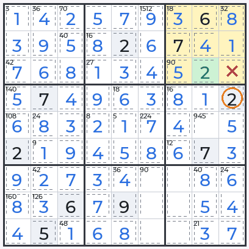

<!-- Written by tools/walkthrough.py product-killer: edit the script, not this page. -->
# Product Killer, step 63: the 2 in box 3

**Step 63 of 71** · [← Step 62](step-62.md) · [All steps](../product-killer.md#the-whole-puzzle-step-by-step) · [Step 64 →](step-64.md)

Box 3 needs a 2. r3c9: column 9 has one (r4c9). Only **r3c8** is left: **r3c8 = 2**.

**Step 63 of 71** · [← Step 62](step-62.md) · [All steps](../product-killer.md#the-whole-puzzle-step-by-step) · [Step 64 →](step-64.md)
