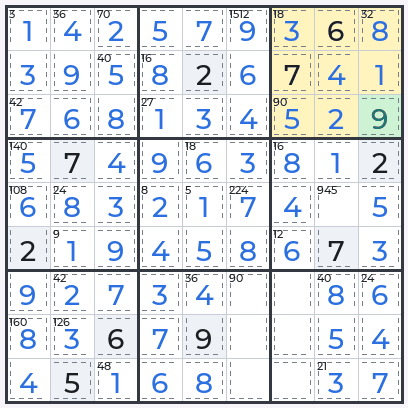

<!-- Written by tools/walkthrough.py product-killer: edit the script, not this page. -->
# Product Killer, step 64: the 9 in box 3

**Step 64 of 71** · [← Step 63](step-63.md) · [All steps](../product-killer.md#the-whole-puzzle-step-by-step) · [Step 65 →](step-65.md)

Box 3 needs a 9, and r3c9 is its last empty cell: **r3c9 = 9**.

**Step 64 of 71** · [← Step 63](step-63.md) · [All steps](../product-killer.md#the-whole-puzzle-step-by-step) · [Step 65 →](step-65.md)
