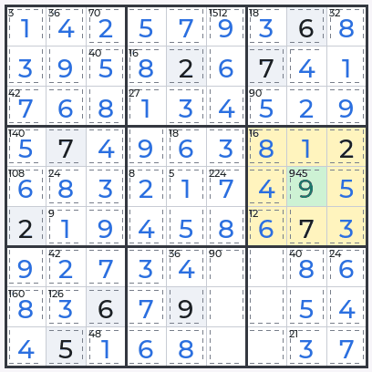

<!-- Written by tools/walkthrough.py product-killer: edit the script, not this page. -->
# Product Killer, step 65: the 9 in box 6

**Step 65 of 71** · [← Step 64](step-64.md) · [All steps](../product-killer.md#the-whole-puzzle-step-by-step) · [Step 66 →](step-66.md)

Box 6 needs a 9, and r5c8 is its last empty cell: **r5c8 = 9**.

**Step 65 of 71** · [← Step 64](step-64.md) · [All steps](../product-killer.md#the-whole-puzzle-step-by-step) · [Step 66 →](step-66.md)
