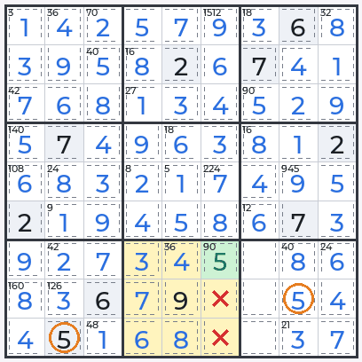

<!-- Written by tools/walkthrough.py product-killer: edit the script, not this page. -->
# Product Killer, step 66: the 5 in box 8

**Step 66 of 71** · [← Step 65](step-65.md) · [All steps](../product-killer.md#the-whole-puzzle-step-by-step) · [Step 67 →](step-67.md)

Box 8 needs a 5. r8c6: row 8 has one (r8c8). r9c6: row 9 has one (r9c2). Only **r7c6** is left: **r7c6 = 5**.

**Step 66 of 71** · [← Step 65](step-65.md) · [All steps](../product-killer.md#the-whole-puzzle-step-by-step) · [Step 67 →](step-67.md)
