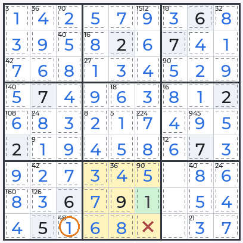

<!-- Written by tools/walkthrough.py product-killer: edit the script, not this page. -->
# Product Killer, step 67: the 1 in box 8

**Step 67 of 71** · [← Step 66](step-66.md) · [All steps](../product-killer.md#the-whole-puzzle-step-by-step) · [Step 68 →](step-68.md)

Box 8 needs a 1. r9c6: row 9 has one (r9c3). Only **r8c6** is left: **r8c6 = 1**.

**Step 67 of 71** · [← Step 66](step-66.md) · [All steps](../product-killer.md#the-whole-puzzle-step-by-step) · [Step 68 →](step-68.md)
