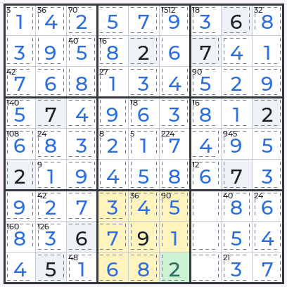

<!-- Written by tools/walkthrough.py product-killer: edit the script, not this page. -->
# Product Killer, step 68: the 2 in box 8

**Step 68 of 71** · [← Step 67](step-67.md) · [All steps](../product-killer.md#the-whole-puzzle-step-by-step) · [Step 69 →](step-69.md)

Box 8 needs a 2, and r9c6 is its last empty cell: **r9c6 = 2**.

**Step 68 of 71** · [← Step 67](step-67.md) · [All steps](../product-killer.md#the-whole-puzzle-step-by-step) · [Step 69 →](step-69.md)
