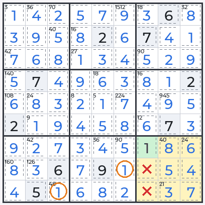

<!-- Written by tools/walkthrough.py product-killer: edit the script, not this page. -->
# Product Killer, step 69: the 1 in box 9

**Step 69 of 71** · [← Step 68](step-68.md) · [All steps](../product-killer.md#the-whole-puzzle-step-by-step) · [Step 70 →](step-70.md)

Box 9 needs a 1. r8c7: row 8 has one (r8c6). r9c7: row 9 has one (r9c3). Only **r7c7** is left: **r7c7 = 1**.

**Step 69 of 71** · [← Step 68](step-68.md) · [All steps](../product-killer.md#the-whole-puzzle-step-by-step) · [Step 70 →](step-70.md)
