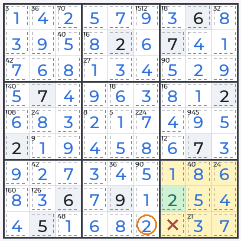

<!-- Written by tools/walkthrough.py product-killer: edit the script, not this page. -->
# Product Killer, step 70: the 2 in box 9

**Step 70 of 71** · [← Step 69](step-69.md) · [All steps](../product-killer.md#the-whole-puzzle-step-by-step) · [Step 71 →](step-71.md)

Box 9 needs a 2. r9c7: row 9 has one (r9c6). Only **r8c7** is left: **r8c7 = 2**.

**Step 70 of 71** · [← Step 69](step-69.md) · [All steps](../product-killer.md#the-whole-puzzle-step-by-step) · [Step 71 →](step-71.md)
