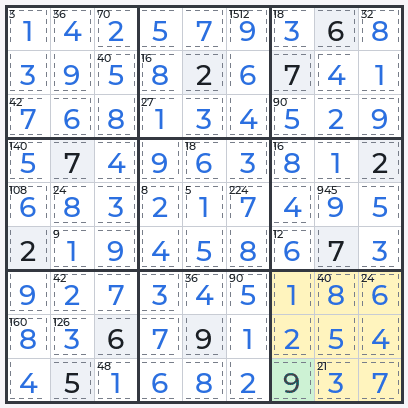

<!-- Written by tools/walkthrough.py product-killer: edit the script, not this page. -->
# Product Killer, step 71: the 9 in box 9

**Step 71 of 71** · [← Step 70](step-70.md) · [All steps](../product-killer.md#the-whole-puzzle-step-by-step) · [All steps](../product-killer.md#the-whole-puzzle-step-by-step)

Box 9 needs a 9, and r9c7 is its last empty cell: **r9c7 = 9**.

Solved.

**Step 71 of 71** · [← Step 70](step-70.md) · [All steps](../product-killer.md#the-whole-puzzle-step-by-step) · [All steps](../product-killer.md#the-whole-puzzle-step-by-step)
