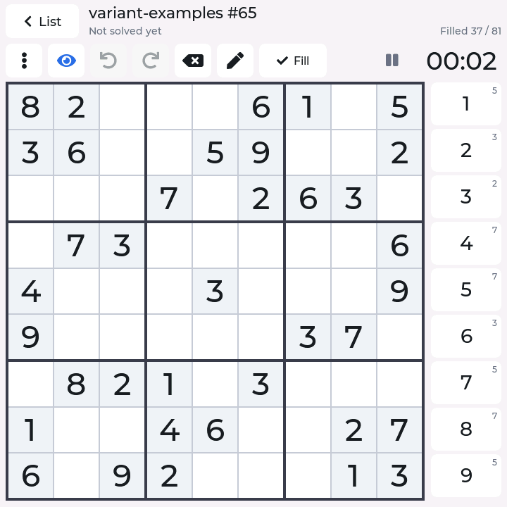
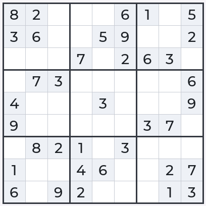

# Quadro

[← All variants](README.md) · [Puzzles](../features-puzzles.md) · [How to play](../how-to-play.md)

## The rules

[Classic](classic.md) rules, and **every 2×2 block of cells holds at least one odd and one even digit**: never four odd or four even digits together. Nothing is drawn on the board: the rule holds for every block, wherever it is (there are 64 of them, overlapping).

## On the board

- The board looks like Classic's; the **?** button in the top bar has the rule.
- A full 2×2 block of four odd or four even digits turns red.
- The grader and hints know one step: when the other three cells of a 2×2 block can only be odd (or only even), the fourth takes the other parity. "Every 2x2 block holds an odd and an even digit. The other three cells of the 2x2 block with row 9, column 5 can only be even, so row 9, column 5 is odd."
- **Puzzles → ⋮ → New puzzle → Marks → Quadro**.

## How to solve it

- **Three of a kind:** look for 2×2 blocks with three odd (or three even) digits; the fourth cell is the other parity.
- **Inside a box:** each of the four 2×2 blocks within a box needs an even digit, and the box has only four of them (2, 4, 6, 8). An even digit in the box's centre serves all four blocks at once; with an odd centre, the evens must spread to reach every block.
- **Parity first, digit later:** knowing a cell is even often leaves only one of its candidates.

## Worked example

**variant-examples #65**, Quadro Easy (see [Classic](classic.md#worked-example-the-whole-puzzle) for how to import the examples; cells are written r*row*c*column*).

**Step 1: r9c5.** Row 9 has 6, 9, 2, 1 and 3; column 5 has 5, 3 and 6; box 8 has 1, 3, 4, 6 and 2. By the Classic rules r9c5 could be 7 or 8. Its 2×2 block with r8c4, r8c5 and r9c4 holds 4, 6 and 2: all even, so r9c5 is odd. **r9c5 = 7**.

**Step 2: the 9 in box 1.** Column 3 has a 9 (r9c3), row 2 too (r2c6) and column 1 (r6c1): **r3c2 = 9**.

**Step 3: r3c3.** Row 3 now has 9, 7, 2, 6 and 3; column 3 has 3, 2 and 9; box 1 has 8, 2, 3, 6 and 9. By the Classic rules r3c3 could be 1, 4 or 5. Its 2×2 block with r3c2, r4c2 and r4c3 holds 9, 7 and 3: all odd, so r3c3 is even. **r3c3 = 4**.

## The whole puzzle, step by step

<!-- walkthrough -->
<!-- Written by tools/walkthrough.py quadro: edit the script, not this part. -->

The whole puzzle, from the start to the last cell: 44 steps, each one a single (one place left for a digit, or one digit left for a cell), taken in the order a box's single comes first, so not quite the order of the worked example above. Each step has a page of its own, with **Previous** and **Next**: pick its number below. In each picture, the unit the step looks at is tinted yellow (for a cell with one digit left: its row, column and box), the new digit is on green, the digits that rule cells out have an **orange ring**, and the empty cells they rule out a **red cross**. Givens are on grey, digits from earlier steps in blue.

| [1](quadro/step-01.md) | [2](quadro/step-02.md) | [3](quadro/step-03.md) | [4](quadro/step-04.md) | [5](quadro/step-05.md) | [6](quadro/step-06.md) | [7](quadro/step-07.md) | [8](quadro/step-08.md) | [9](quadro/step-09.md) | [10](quadro/step-10.md) |
|:-:|:-:|:-:|:-:|:-:|:-:|:-:|:-:|:-:|:-:|
| [11](quadro/step-11.md) | [12](quadro/step-12.md) | [13](quadro/step-13.md) | [14](quadro/step-14.md) | [15](quadro/step-15.md) | [16](quadro/step-16.md) | [17](quadro/step-17.md) | [18](quadro/step-18.md) | [19](quadro/step-19.md) | [20](quadro/step-20.md) |
| [21](quadro/step-21.md) | [22](quadro/step-22.md) | [23](quadro/step-23.md) | [24](quadro/step-24.md) | [25](quadro/step-25.md) | [26](quadro/step-26.md) | [27](quadro/step-27.md) | [28](quadro/step-28.md) | [29](quadro/step-29.md) | [30](quadro/step-30.md) |
| [31](quadro/step-31.md) | [32](quadro/step-32.md) | [33](quadro/step-33.md) | [34](quadro/step-34.md) | [35](quadro/step-35.md) | [36](quadro/step-36.md) | [37](quadro/step-37.md) | [38](quadro/step-38.md) | [39](quadro/step-39.md) | [40](quadro/step-40.md) |
| [41](quadro/step-41.md) | [42](quadro/step-42.md) | [43](quadro/step-43.md) | [44](quadro/step-44.md) |  |  |  |  |  |  |

Solved.

<!-- /walkthrough -->
