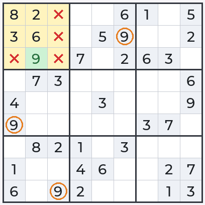

<!-- Written by tools/walkthrough.py quadro: edit the script, not this page. -->
# Quadro, step 1: the 9 in box 1

**Step 1 of 44** · [← The start](../quadro.md#the-whole-puzzle-step-by-step) · [All steps](../quadro.md#the-whole-puzzle-step-by-step) · [Step 2 →](step-02.md)

Box 1 needs a 9. r1c3 and r3c3: column 3 has one (r9c3). r2c3: row 2 has one (r2c6). r3c1: column 1 has one (r6c1). Only **r3c2** is left: **r3c2 = 9**.

**Step 1 of 44** · [← The start](../quadro.md#the-whole-puzzle-step-by-step) · [All steps](../quadro.md#the-whole-puzzle-step-by-step) · [Step 2 →](step-02.md)
