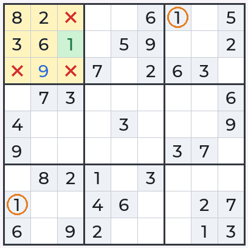

<!-- Written by tools/walkthrough.py quadro: edit the script, not this page. -->
# Quadro, step 2: the 1 in box 1

**Step 2 of 44** · [← Step 1](step-01.md) · [All steps](../quadro.md#the-whole-puzzle-step-by-step) · [Step 3 →](step-03.md)

Box 1 needs a 1. r1c3: row 1 has one (r1c7). r3c1: column 1 has one (r8c1). r3c3: 9 in r3c2, 7 in r4c2 and 3 in r4c3 are odd too, so its 2x2 block would hold no even digit. Only **r2c3** is left: **r2c3 = 1**.

**Step 2 of 44** · [← Step 1](step-01.md) · [All steps](../quadro.md#the-whole-puzzle-step-by-step) · [Step 3 →](step-03.md)
