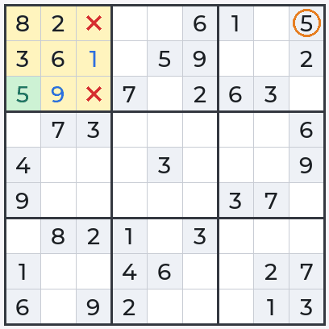

<!-- Written by tools/walkthrough.py quadro: edit the script, not this page. -->
# Quadro, step 3: the 5 in box 1

**Step 3 of 44** · [← Step 2](step-02.md) · [All steps](../quadro.md#the-whole-puzzle-step-by-step) · [Step 4 →](step-04.md)

Box 1 needs a 5. r1c3: row 1 has one (r1c9). r3c3: 9 in r3c2, 7 in r4c2 and 3 in r4c3 are odd too, so its 2x2 block would hold no even digit. Only **r3c1** is left: **r3c1 = 5**.

**Step 3 of 44** · [← Step 2](step-02.md) · [All steps](../quadro.md#the-whole-puzzle-step-by-step) · [Step 4 →](step-04.md)
