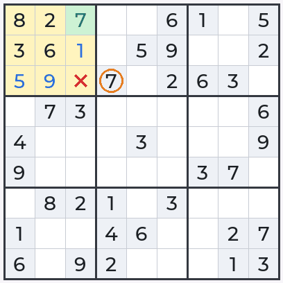

<!-- Written by tools/walkthrough.py quadro: edit the script, not this page. -->
# Quadro, step 4: the 7 in box 1

**Step 4 of 44** · [← Step 3](step-03.md) · [All steps](../quadro.md#the-whole-puzzle-step-by-step) · [Step 5 →](step-05.md)

Box 1 needs a 7. r3c3: row 3 has one (r3c4). Only **r1c3** is left: **r1c3 = 7**.

**Step 4 of 44** · [← Step 3](step-03.md) · [All steps](../quadro.md#the-whole-puzzle-step-by-step) · [Step 5 →](step-05.md)
