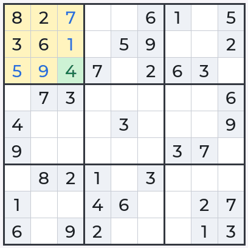

<!-- Written by tools/walkthrough.py quadro: edit the script, not this page. -->
# Quadro, step 5: the 4 in box 1

**Step 5 of 44** · [← Step 4](step-04.md) · [All steps](../quadro.md#the-whole-puzzle-step-by-step) · [Step 6 →](step-06.md)

Box 1 needs a 4, and r3c3 is its last empty cell: **r3c3 = 4**.

**Step 5 of 44** · [← Step 4](step-04.md) · [All steps](../quadro.md#the-whole-puzzle-step-by-step) · [Step 6 →](step-06.md)
