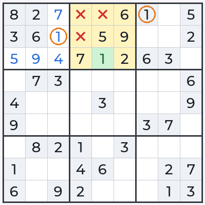

<!-- Written by tools/walkthrough.py quadro: edit the script, not this page. -->
# Quadro, step 6: the 1 in box 2

**Step 6 of 44** · [← Step 5](step-05.md) · [All steps](../quadro.md#the-whole-puzzle-step-by-step) · [Step 7 →](step-07.md)

Box 2 needs a 1. r1c4 and r1c5: row 1 has one (r1c7). r2c4: row 2 has one (r2c3). Only **r3c5** is left: **r3c5 = 1**.

**Step 6 of 44** · [← Step 5](step-05.md) · [All steps](../quadro.md#the-whole-puzzle-step-by-step) · [Step 7 →](step-07.md)
