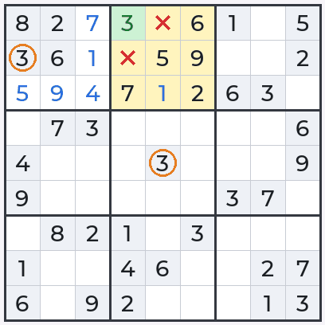

<!-- Written by tools/walkthrough.py quadro: edit the script, not this page. -->
# Quadro, step 7: the 3 in box 2

**Step 7 of 44** · [← Step 6](step-06.md) · [All steps](../quadro.md#the-whole-puzzle-step-by-step) · [Step 8 →](step-08.md)

Box 2 needs a 3. r1c5: column 5 has one (r5c5). r2c4: row 2 has one (r2c1). Only **r1c4** is left: **r1c4 = 3**.

**Step 7 of 44** · [← Step 6](step-06.md) · [All steps](../quadro.md#the-whole-puzzle-step-by-step) · [Step 8 →](step-08.md)
