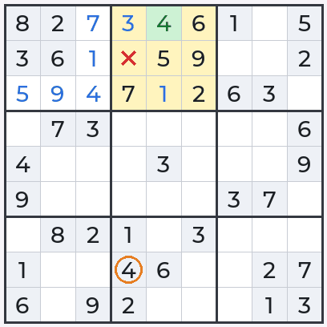

<!-- Written by tools/walkthrough.py quadro: edit the script, not this page. -->
# Quadro, step 8: the 4 in box 2

**Step 8 of 44** · [← Step 7](step-07.md) · [All steps](../quadro.md#the-whole-puzzle-step-by-step) · [Step 9 →](step-09.md)

Box 2 needs a 4. r2c4: column 4 has one (r8c4). Only **r1c5** is left: **r1c5 = 4**.

**Step 8 of 44** · [← Step 7](step-07.md) · [All steps](../quadro.md#the-whole-puzzle-step-by-step) · [Step 9 →](step-09.md)
