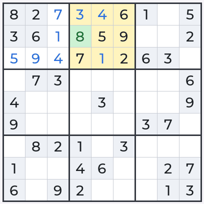

<!-- Written by tools/walkthrough.py quadro: edit the script, not this page. -->
# Quadro, step 9: the 8 in box 2

**Step 9 of 44** · [← Step 8](step-08.md) · [All steps](../quadro.md#the-whole-puzzle-step-by-step) · [Step 10 →](step-10.md)

Box 2 needs an 8, and r2c4 is its last empty cell: **r2c4 = 8**.

**Step 9 of 44** · [← Step 8](step-08.md) · [All steps](../quadro.md#the-whole-puzzle-step-by-step) · [Step 10 →](step-10.md)
