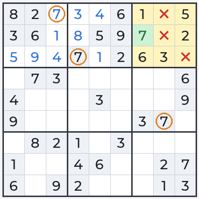

<!-- Written by tools/walkthrough.py quadro: edit the script, not this page. -->
# Quadro, step 10: the 7 in box 3

**Step 10 of 44** · [← Step 9](step-09.md) · [All steps](../quadro.md#the-whole-puzzle-step-by-step) · [Step 11 →](step-11.md)

Box 3 needs a 7. r1c8: row 1 has one (r1c3). r2c8: column 8 has one (r6c8). r3c9: row 3 has one (r3c4). Only **r2c7** is left: **r2c7 = 7**.

**Step 10 of 44** · [← Step 9](step-09.md) · [All steps](../quadro.md#the-whole-puzzle-step-by-step) · [Step 11 →](step-11.md)
