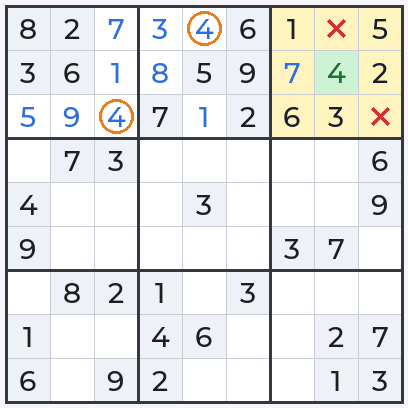

<!-- Written by tools/walkthrough.py quadro: edit the script, not this page. -->
# Quadro, step 11: the 4 in box 3

**Step 11 of 44** · [← Step 10](step-10.md) · [All steps](../quadro.md#the-whole-puzzle-step-by-step) · [Step 12 →](step-12.md)

Box 3 needs a 4. r1c8: row 1 has one (r1c5). r3c9: row 3 has one (r3c3). Only **r2c8** is left: **r2c8 = 4**.

**Step 11 of 44** · [← Step 10](step-10.md) · [All steps](../quadro.md#the-whole-puzzle-step-by-step) · [Step 12 →](step-12.md)
