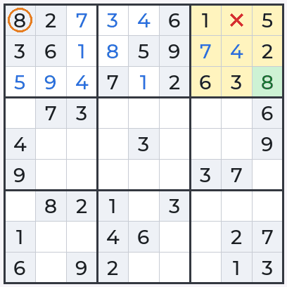

<!-- Written by tools/walkthrough.py quadro: edit the script, not this page. -->
# Quadro, step 12: the 8 in box 3

**Step 12 of 44** · [← Step 11](step-11.md) · [All steps](../quadro.md#the-whole-puzzle-step-by-step) · [Step 13 →](step-13.md)

Box 3 needs an 8. r1c8: row 1 has one (r1c1). Only **r3c9** is left: **r3c9 = 8**.

**Step 12 of 44** · [← Step 11](step-11.md) · [All steps](../quadro.md#the-whole-puzzle-step-by-step) · [Step 13 →](step-13.md)
