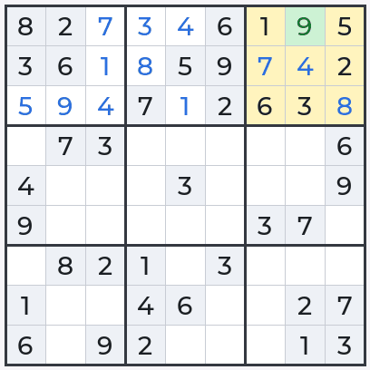

<!-- Written by tools/walkthrough.py quadro: edit the script, not this page. -->
# Quadro, step 13: the 9 in box 3

**Step 13 of 44** · [← Step 12](step-12.md) · [All steps](../quadro.md#the-whole-puzzle-step-by-step) · [Step 14 →](step-14.md)

Box 3 needs a 9, and r1c8 is its last empty cell: **r1c8 = 9**.

**Step 13 of 44** · [← Step 12](step-12.md) · [All steps](../quadro.md#the-whole-puzzle-step-by-step) · [Step 14 →](step-14.md)
