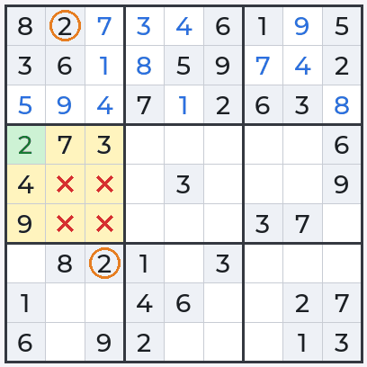

<!-- Written by tools/walkthrough.py quadro: edit the script, not this page. -->
# Quadro, step 14: the 2 in box 4

**Step 14 of 44** · [← Step 13](step-13.md) · [All steps](../quadro.md#the-whole-puzzle-step-by-step) · [Step 15 →](step-15.md)

Box 4 needs a 2. r5c2 and r6c2: column 2 has one (r1c2). r5c3 and r6c3: column 3 has one (r7c3). Only **r4c1** is left: **r4c1 = 2**.

**Step 14 of 44** · [← Step 13](step-13.md) · [All steps](../quadro.md#the-whole-puzzle-step-by-step) · [Step 15 →](step-15.md)
