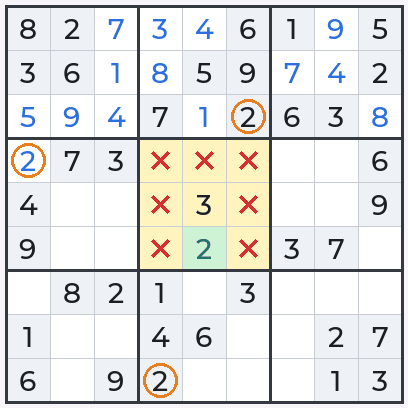

<!-- Written by tools/walkthrough.py quadro: edit the script, not this page. -->
# Quadro, step 15: the 2 in box 5

**Step 15 of 44** · [← Step 14](step-14.md) · [All steps](../quadro.md#the-whole-puzzle-step-by-step) · [Step 16 →](step-16.md)

Box 5 needs a 2. r4c4, r4c5 and r4c6: row 4 has one (r4c1). r5c4 and r6c4: column 4 has one (r9c4). r5c6 and r6c6: column 6 has one (r3c6). Only **r6c5** is left: **r6c5 = 2**.

**Step 15 of 44** · [← Step 14](step-14.md) · [All steps](../quadro.md#the-whole-puzzle-step-by-step) · [Step 16 →](step-16.md)
