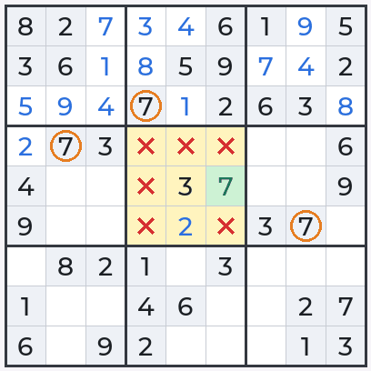

<!-- Written by tools/walkthrough.py quadro: edit the script, not this page. -->
# Quadro, step 16: the 7 in box 5

**Step 16 of 44** · [← Step 15](step-15.md) · [All steps](../quadro.md#the-whole-puzzle-step-by-step) · [Step 17 →](step-17.md)

Box 5 needs a 7. r4c4, r4c5 and r4c6: row 4 has one (r4c2). r5c4: column 4 has one (r3c4). r6c4 and r6c6: row 6 has one (r6c8). Only **r5c6** is left: **r5c6 = 7**.

**Step 16 of 44** · [← Step 15](step-15.md) · [All steps](../quadro.md#the-whole-puzzle-step-by-step) · [Step 17 →](step-17.md)
