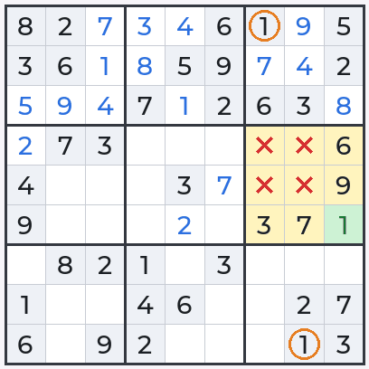

<!-- Written by tools/walkthrough.py quadro: edit the script, not this page. -->
# Quadro, step 17: the 1 in box 6

**Step 17 of 44** · [← Step 16](step-16.md) · [All steps](../quadro.md#the-whole-puzzle-step-by-step) · [Step 18 →](step-18.md)

Box 6 needs a 1. r4c7 and r5c7: column 7 has one (r1c7). r4c8 and r5c8: column 8 has one (r9c8). Only **r6c9** is left: **r6c9 = 1**.

**Step 17 of 44** · [← Step 16](step-16.md) · [All steps](../quadro.md#the-whole-puzzle-step-by-step) · [Step 18 →](step-18.md)
