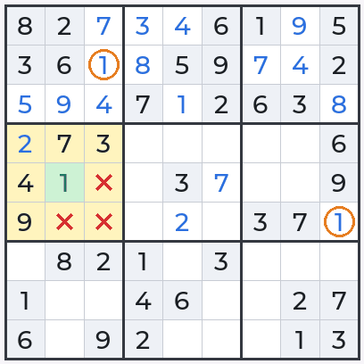

<!-- Written by tools/walkthrough.py quadro: edit the script, not this page. -->
# Quadro, step 18: the 1 in box 4

**Step 18 of 44** · [← Step 17](step-17.md) · [All steps](../quadro.md#the-whole-puzzle-step-by-step) · [Step 19 →](step-19.md)

Box 4 needs a 1. r5c3: column 3 has one (r2c3). r6c2 and r6c3: row 6 has one (r6c9). Only **r5c2** is left: **r5c2 = 1**.

**Step 18 of 44** · [← Step 17](step-17.md) · [All steps](../quadro.md#the-whole-puzzle-step-by-step) · [Step 19 →](step-19.md)
