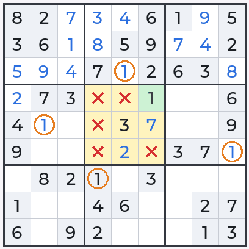

<!-- Written by tools/walkthrough.py quadro: edit the script, not this page. -->
# Quadro, step 19: the 1 in box 5

**Step 19 of 44** · [← Step 18](step-18.md) · [All steps](../quadro.md#the-whole-puzzle-step-by-step) · [Step 20 →](step-20.md)

Box 5 needs a 1. r4c4: column 4 has one (r7c4). r4c5: column 5 has one (r3c5). r5c4: row 5 has one (r5c2). r6c4 and r6c6: row 6 has one (r6c9). Only **r4c6** is left: **r4c6 = 1**.

**Step 19 of 44** · [← Step 18](step-18.md) · [All steps](../quadro.md#the-whole-puzzle-step-by-step) · [Step 20 →](step-20.md)
