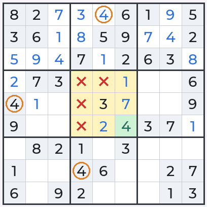

<!-- Written by tools/walkthrough.py quadro: edit the script, not this page. -->
# Quadro, step 20: the 4 in box 5

**Step 20 of 44** · [← Step 19](step-19.md) · [All steps](../quadro.md#the-whole-puzzle-step-by-step) · [Step 21 →](step-21.md)

Box 5 needs a 4. r4c4 and r6c4: column 4 has one (r8c4). r4c5: column 5 has one (r1c5). r5c4: row 5 has one (r5c1). Only **r6c6** is left: **r6c6 = 4**.

**Step 20 of 44** · [← Step 19](step-19.md) · [All steps](../quadro.md#the-whole-puzzle-step-by-step) · [Step 21 →](step-21.md)
