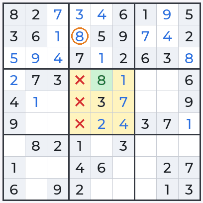

<!-- Written by tools/walkthrough.py quadro: edit the script, not this page. -->
# Quadro, step 21: the 8 in box 5

**Step 21 of 44** · [← Step 20](step-20.md) · [All steps](../quadro.md#the-whole-puzzle-step-by-step) · [Step 22 →](step-22.md)

Box 5 needs an 8. r4c4, r5c4 and r6c4: column 4 has one (r2c4). Only **r4c5** is left: **r4c5 = 8**.

**Step 21 of 44** · [← Step 20](step-20.md) · [All steps](../quadro.md#the-whole-puzzle-step-by-step) · [Step 22 →](step-22.md)
