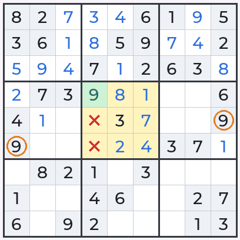

<!-- Written by tools/walkthrough.py quadro: edit the script, not this page. -->
# Quadro, step 22: the 9 in box 5

**Step 22 of 44** · [← Step 21](step-21.md) · [All steps](../quadro.md#the-whole-puzzle-step-by-step) · [Step 23 →](step-23.md)

Box 5 needs a 9. r5c4: row 5 has one (r5c9). r6c4: row 6 has one (r6c1). Only **r4c4** is left: **r4c4 = 9**.

**Step 22 of 44** · [← Step 21](step-21.md) · [All steps](../quadro.md#the-whole-puzzle-step-by-step) · [Step 23 →](step-23.md)
