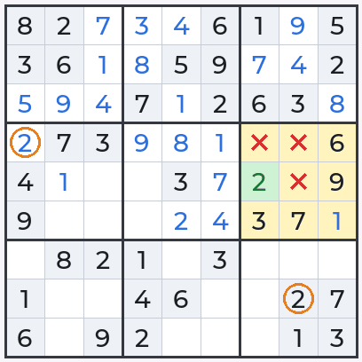

<!-- Written by tools/walkthrough.py quadro: edit the script, not this page. -->
# Quadro, step 23: the 2 in box 6

**Step 23 of 44** · [← Step 22](step-22.md) · [All steps](../quadro.md#the-whole-puzzle-step-by-step) · [Step 24 →](step-24.md)

Box 6 needs a 2. r4c7 and r4c8: row 4 has one (r4c1). r5c8: column 8 has one (r8c8). Only **r5c7** is left: **r5c7 = 2**.

**Step 23 of 44** · [← Step 22](step-22.md) · [All steps](../quadro.md#the-whole-puzzle-step-by-step) · [Step 24 →](step-24.md)
