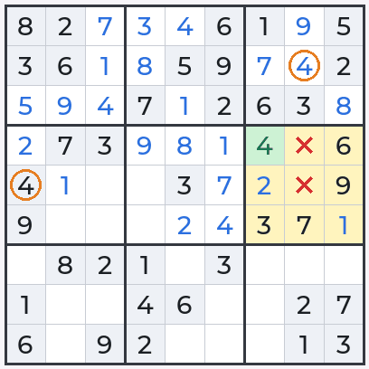

<!-- Written by tools/walkthrough.py quadro: edit the script, not this page. -->
# Quadro, step 24: the 4 in box 6

**Step 24 of 44** · [← Step 23](step-23.md) · [All steps](../quadro.md#the-whole-puzzle-step-by-step) · [Step 25 →](step-25.md)

Box 6 needs a 4. r4c8: column 8 has one (r2c8). r5c8: row 5 has one (r5c1). Only **r4c7** is left: **r4c7 = 4**.

**Step 24 of 44** · [← Step 23](step-23.md) · [All steps](../quadro.md#the-whole-puzzle-step-by-step) · [Step 25 →](step-25.md)
