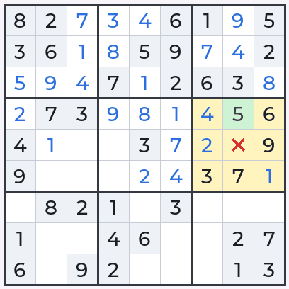

<!-- Written by tools/walkthrough.py quadro: edit the script, not this page. -->
# Quadro, step 25: the 5 in box 6

**Step 25 of 44** · [← Step 24](step-24.md) · [All steps](../quadro.md#the-whole-puzzle-step-by-step) · [Step 26 →](step-26.md)

Box 6 needs a 5. r5c8: 9 in r5c9, 7 in r6c8 and 1 in r6c9 are odd too, so its 2x2 block would hold no even digit. Only **r4c8** is left: **r4c8 = 5**.

**Step 25 of 44** · [← Step 24](step-24.md) · [All steps](../quadro.md#the-whole-puzzle-step-by-step) · [Step 26 →](step-26.md)
