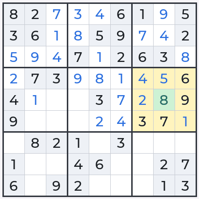

<!-- Written by tools/walkthrough.py quadro: edit the script, not this page. -->
# Quadro, step 26: the 8 in box 6

**Step 26 of 44** · [← Step 25](step-25.md) · [All steps](../quadro.md#the-whole-puzzle-step-by-step) · [Step 27 →](step-27.md)

Box 6 needs an 8, and r5c8 is its last empty cell: **r5c8 = 8**.

**Step 26 of 44** · [← Step 25](step-25.md) · [All steps](../quadro.md#the-whole-puzzle-step-by-step) · [Step 27 →](step-27.md)
