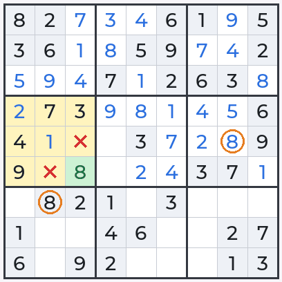

<!-- Written by tools/walkthrough.py quadro: edit the script, not this page. -->
# Quadro, step 27: the 8 in box 4

**Step 27 of 44** · [← Step 26](step-26.md) · [All steps](../quadro.md#the-whole-puzzle-step-by-step) · [Step 28 →](step-28.md)

Box 4 needs an 8. r5c3: row 5 has one (r5c8). r6c2: column 2 has one (r7c2). Only **r6c3** is left: **r6c3 = 8**.

**Step 27 of 44** · [← Step 26](step-26.md) · [All steps](../quadro.md#the-whole-puzzle-step-by-step) · [Step 28 →](step-28.md)
