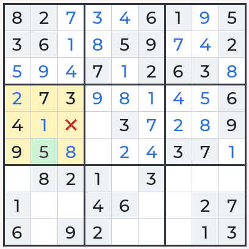

<!-- Written by tools/walkthrough.py quadro: edit the script, not this page. -->
# Quadro, step 28: the 5 in box 4

**Step 28 of 44** · [← Step 27](step-27.md) · [All steps](../quadro.md#the-whole-puzzle-step-by-step) · [Step 29 →](step-29.md)

Box 4 needs a 5. r5c3: 7 in r4c2, 3 in r4c3 and 1 in r5c2 are odd too, so its 2x2 block would hold no even digit. Only **r6c2** is left: **r6c2 = 5**.

**Step 28 of 44** · [← Step 27](step-27.md) · [All steps](../quadro.md#the-whole-puzzle-step-by-step) · [Step 29 →](step-29.md)
