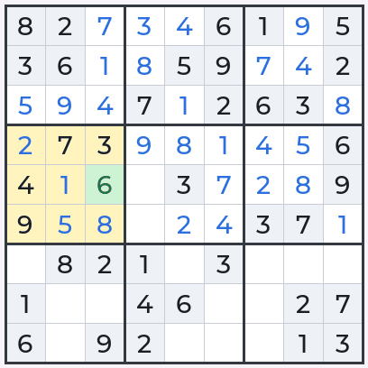

<!-- Written by tools/walkthrough.py quadro: edit the script, not this page. -->
# Quadro, step 29: the 6 in box 4

**Step 29 of 44** · [← Step 28](step-28.md) · [All steps](../quadro.md#the-whole-puzzle-step-by-step) · [Step 30 →](step-30.md)

Box 4 needs a 6, and r5c3 is its last empty cell: **r5c3 = 6**.

**Step 29 of 44** · [← Step 28](step-28.md) · [All steps](../quadro.md#the-whole-puzzle-step-by-step) · [Step 30 →](step-30.md)
