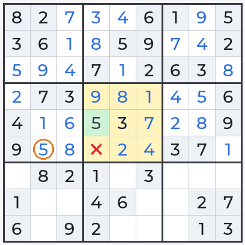

<!-- Written by tools/walkthrough.py quadro: edit the script, not this page. -->
# Quadro, step 30: the 5 in box 5

**Step 30 of 44** · [← Step 29](step-29.md) · [All steps](../quadro.md#the-whole-puzzle-step-by-step) · [Step 31 →](step-31.md)

Box 5 needs a 5. r6c4: row 6 has one (r6c2). Only **r5c4** is left: **r5c4 = 5**.

**Step 30 of 44** · [← Step 29](step-29.md) · [All steps](../quadro.md#the-whole-puzzle-step-by-step) · [Step 31 →](step-31.md)
