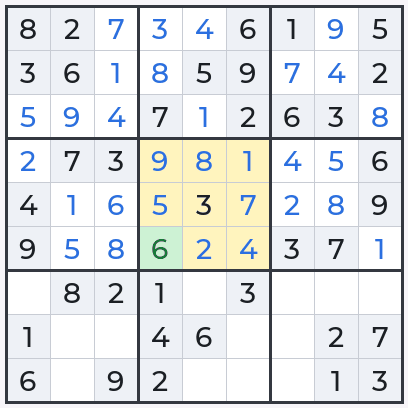

<!-- Written by tools/walkthrough.py quadro: edit the script, not this page. -->
# Quadro, step 31: the 6 in box 5

**Step 31 of 44** · [← Step 30](step-30.md) · [All steps](../quadro.md#the-whole-puzzle-step-by-step) · [Step 32 →](step-32.md)

Box 5 needs a 6, and r6c4 is its last empty cell: **r6c4 = 6**.

**Step 31 of 44** · [← Step 30](step-30.md) · [All steps](../quadro.md#the-whole-puzzle-step-by-step) · [Step 32 →](step-32.md)
