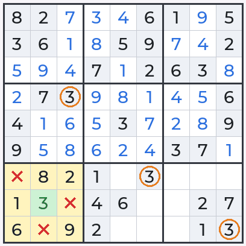

<!-- Written by tools/walkthrough.py quadro: edit the script, not this page. -->
# Quadro, step 32: the 3 in box 7

**Step 32 of 44** · [← Step 31](step-31.md) · [All steps](../quadro.md#the-whole-puzzle-step-by-step) · [Step 33 →](step-33.md)

Box 7 needs a 3. r7c1: row 7 has one (r7c6). r8c3: column 3 has one (r4c3). r9c2: row 9 has one (r9c9). Only **r8c2** is left: **r8c2 = 3**.

**Step 32 of 44** · [← Step 31](step-31.md) · [All steps](../quadro.md#the-whole-puzzle-step-by-step) · [Step 33 →](step-33.md)
