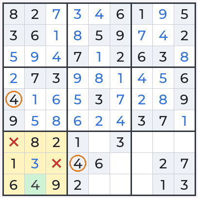

<!-- Written by tools/walkthrough.py quadro: edit the script, not this page. -->
# Quadro, step 33: the 4 in box 7

**Step 33 of 44** · [← Step 32](step-32.md) · [All steps](../quadro.md#the-whole-puzzle-step-by-step) · [Step 34 →](step-34.md)

Box 7 needs a 4. r7c1: column 1 has one (r5c1). r8c3: row 8 has one (r8c4). Only **r9c2** is left: **r9c2 = 4**.

**Step 33 of 44** · [← Step 32](step-32.md) · [All steps](../quadro.md#the-whole-puzzle-step-by-step) · [Step 34 →](step-34.md)
