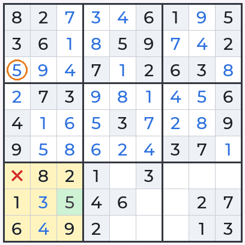

<!-- Written by tools/walkthrough.py quadro: edit the script, not this page. -->
# Quadro, step 34: the 5 in box 7

**Step 34 of 44** · [← Step 33](step-33.md) · [All steps](../quadro.md#the-whole-puzzle-step-by-step) · [Step 35 →](step-35.md)

Box 7 needs a 5. r7c1: column 1 has one (r3c1). Only **r8c3** is left: **r8c3 = 5**.

**Step 34 of 44** · [← Step 33](step-33.md) · [All steps](../quadro.md#the-whole-puzzle-step-by-step) · [Step 35 →](step-35.md)
