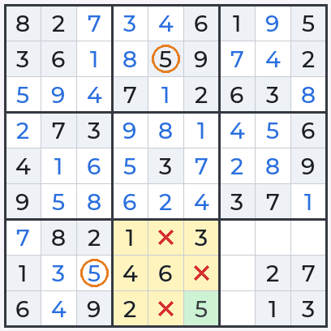

<!-- Written by tools/walkthrough.py quadro: edit the script, not this page. -->
# Quadro, step 36: the 5 in box 8

**Step 36 of 44** · [← Step 35](step-35.md) · [All steps](../quadro.md#the-whole-puzzle-step-by-step) · [Step 37 →](step-37.md)

Box 8 needs a 5. r7c5 and r9c5: column 5 has one (r2c5). r8c6: row 8 has one (r8c3). Only **r9c6** is left: **r9c6 = 5**.

**Step 36 of 44** · [← Step 35](step-35.md) · [All steps](../quadro.md#the-whole-puzzle-step-by-step) · [Step 37 →](step-37.md)
