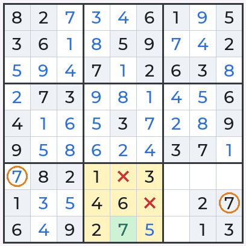

<!-- Written by tools/walkthrough.py quadro: edit the script, not this page. -->
# Quadro, step 37: the 7 in box 8

**Step 37 of 44** · [← Step 36](step-36.md) · [All steps](../quadro.md#the-whole-puzzle-step-by-step) · [Step 38 →](step-38.md)

Box 8 needs a 7. r7c5: row 7 has one (r7c1). r8c6: row 8 has one (r8c9). Only **r9c5** is left: **r9c5 = 7**.

**Step 37 of 44** · [← Step 36](step-36.md) · [All steps](../quadro.md#the-whole-puzzle-step-by-step) · [Step 38 →](step-38.md)
