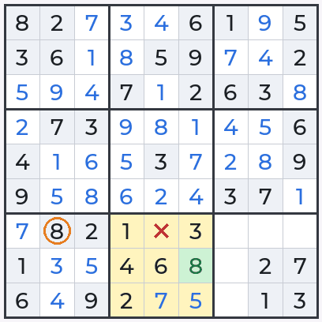

<!-- Written by tools/walkthrough.py quadro: edit the script, not this page. -->
# Quadro, step 38: the 8 in box 8

**Step 38 of 44** · [← Step 37](step-37.md) · [All steps](../quadro.md#the-whole-puzzle-step-by-step) · [Step 39 →](step-39.md)

Box 8 needs an 8. r7c5: row 7 has one (r7c2). Only **r8c6** is left: **r8c6 = 8**.

**Step 38 of 44** · [← Step 37](step-37.md) · [All steps](../quadro.md#the-whole-puzzle-step-by-step) · [Step 39 →](step-39.md)
