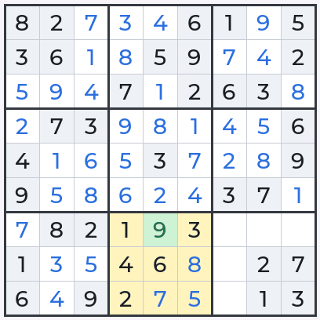

<!-- Written by tools/walkthrough.py quadro: edit the script, not this page. -->
# Quadro, step 39: the 9 in box 8

**Step 39 of 44** · [← Step 38](step-38.md) · [All steps](../quadro.md#the-whole-puzzle-step-by-step) · [Step 40 →](step-40.md)

Box 8 needs a 9, and r7c5 is its last empty cell: **r7c5 = 9**.

**Step 39 of 44** · [← Step 38](step-38.md) · [All steps](../quadro.md#the-whole-puzzle-step-by-step) · [Step 40 →](step-40.md)
