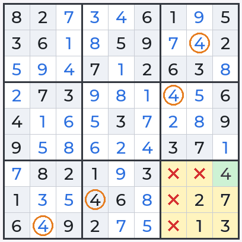

<!-- Written by tools/walkthrough.py quadro: edit the script, not this page. -->
# Quadro, step 40: the 4 in box 9

**Step 40 of 44** · [← Step 39](step-39.md) · [All steps](../quadro.md#the-whole-puzzle-step-by-step) · [Step 41 →](step-41.md)

Box 9 needs a 4. r7c7: column 7 has one (r4c7). r7c8: column 8 has one (r2c8). r8c7: row 8 has one (r8c4). r9c7: row 9 has one (r9c2). Only **r7c9** is left: **r7c9 = 4**.

**Step 40 of 44** · [← Step 39](step-39.md) · [All steps](../quadro.md#the-whole-puzzle-step-by-step) · [Step 41 →](step-41.md)
