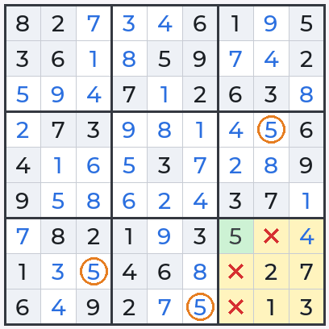

<!-- Written by tools/walkthrough.py quadro: edit the script, not this page. -->
# Quadro, step 41: the 5 in box 9

**Step 41 of 44** · [← Step 40](step-40.md) · [All steps](../quadro.md#the-whole-puzzle-step-by-step) · [Step 42 →](step-42.md)

Box 9 needs a 5. r7c8: column 8 has one (r4c8). r8c7: row 8 has one (r8c3). r9c7: row 9 has one (r9c6). Only **r7c7** is left: **r7c7 = 5**.

**Step 41 of 44** · [← Step 40](step-40.md) · [All steps](../quadro.md#the-whole-puzzle-step-by-step) · [Step 42 →](step-42.md)
